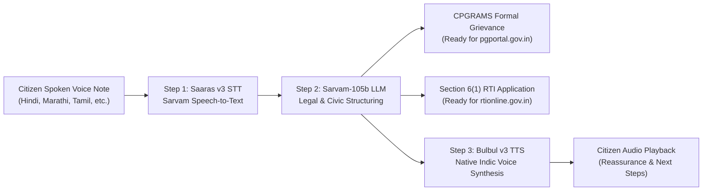

# Awaz-e-Shikayat (आवाज़-ए-शिकायत)
### *Indic Voice-to-CPGRAMS Grievance & RTI Copilot powered by Sarvam AI*

[-black?style=flat&logo=next.js)](https://nextjs.org/)
[](https://www.sarvam.ai/)
[](https://www.typescriptlang.org/)
[](https://tailwindcss.com/)

---

## 🏛️ The Problem Solved
Across India, hundreds of millions of citizens face severe public breakdowns—ruptured water pipelines, dangerous highway potholes, illegal denial of subsidized ration grain, and hospital negligence. 

While the Government of India provides powerful constitutional redress mechanisms—notably **CPGRAMS (Centralized Public Grievance Redress and Monitoring System)** and the **Right to Information (RTI) Act, 2005 (Section 6(1))**—most citizens are disenfranchised because:
1. Grievance portals demand formal legal and administrative English phrasing.
2. Citizens do not know which Central Ministry, State Department, or Urban Local Body (ULB) holds statutory jurisdiction.
3. Bureaucratic complaints are often closed without accountability unless accompanied by sharp, legally binding RTI questions requesting inspection logs, contractor agreements, and daily action records.

**Awaz-e-Shikayat** bridges this gap completely. A citizen speaks in their mother tongue (Hindi, Marathi, Tamil, Telugu, Kannada, Bengali), and within seconds receives:
- A submission-ready, high-impact **CPGRAMS formal grievance**.
- A legally enforceable **RTI Section 6(1) application**.
- An empathetic **spoken voice confirmation** in their native tongue explaining what was drafted and the immediate next step.

---

## ⚡ 3-Step Sarvam AI Architecture Pipeline



1. **Step 1 — Speech-to-Text (`Saaras:v3`)**:
   Captures raw, code-mixed Indic audio directly from the browser microphone (`MediaRecorder`) or uploaded `.wav`/`.mp3`/`.webm` audio files and delivers high-fidelity vernacular transcripts.
2. **Step 2 — Legal & Civic Structuring (`sarvam-105b-conversations`)**:
   Analyzes the grievance, tags the official Indian ministry or civic body (e.g., *Ministry of Jal Shakti / Municipal Water Works*, *Public Works Department (PWD)*, *Food & Public Distribution*), classifies urgency (`Critical` / `High` / `Medium`), drafts a formal CPGRAMS petition with legal relief sought, and formulates 4 sharp questions under Section 6(1) of the RTI Act 2005.
3. **Step 3 — Native Voice Reassurance (`Bulbul:v3`)**:
   Synthesizes an empathetic audio confirmation in the citizen's native language, playable directly in the browser.

---

## 🚀 Live Demo Features (For Hackathon Judges)

- **🎙️ Dual Input Mode**:
  - **Live Browser Microphone**: Click or hold to record audio with live second counter.
  - **1-Click Sample Scenarios**: Instant preset buttons (*Ward 14 Burst Pipeline in Hindi*, *Ration Denial in Marathi*, *Highway Pothole in Tamil*) allow testing the full end-to-end pipeline in one click without a microphone.
- **🔊 Auto-Play Indic Voice Banner**: Browser playback of the `Bulbul v3` synthesized WAV audio alongside native text reassurance.
- **📋 One-Click Action Cards**:
  - Copy to Clipboard & Download `.txt` for CPGRAMS drafts.
  - Copy to Clipboard & Download `.txt` for RTI Section 6(1) applications.
  - Direct deep links to [pgportal.gov.in](https://pgportal.gov.in/) and [rtionline.gov.in](https://rtionline.gov.in/).

---

## 🛠️ Local Setup & Verification

### 1. Prerequisites
- Node.js 18+ (tested on Node v24)
- npm 9+
- A valid Sarvam AI API Key ([docs.sarvam.ai](https://docs.sarvam.ai/))

### 2. Installation
```bash
git clone <your-repo-url>
cd sarvam_proj
npm install
```

### 3. Environment Configuration
Create a `.env` (or `.env.local`) file in the project root:
```env
SARVAM_API_KEY=your_sarvam_api_key_here
```
> **Security Note:** `.env` and `.env*.local` are explicitly listed in `.gitignore`. Never commit API keys.

### 4. Run the Standalone Verification Script
Verify that your Sarvam AI connection is working:
```bash
node verify_sarvam.mjs
```
Expected output:
```
Connecting to Sarvam AI...
--- Sarvam AI Chat Completion Response ---
Namaste! Hello! Aapki seva mein upasthit hain. How may I assist you today?
-------------------------------------------
Verification SUCCESSFUL!
```

### 5. Launch the Application
```bash
npm run dev
```
Open [http://localhost:3000](http://localhost:3000) to view the app.

---

## 🚢 Production Deployment on Vercel

This repository is optimized for zero-configuration Vercel deployment:

1. **Push to GitHub**:
   ```bash
   git add .
   git commit -m "feat: Awaz-e-Shikayat production release"
   git branch -M main
   git remote add origin https://github.com/<your-username>/awaz-e-shikayat.git
   git push -u origin main
   ```

2. **Deploy to Vercel**:
   - Import the repository on [Vercel](https://vercel.com).
   - In **Project Settings -> Environment Variables**, add:
     - `SARVAM_API_KEY`: `your_sarvam_api_key_here`
   - Click **Deploy**.

   Or deploy instantly via the Vercel CLI:
   ```bash
   npx vercel --prod
   ```

---

## 📄 License & Attribution
Built for the **Sarvam AI Hackathon**. Powered by the official `sarvamai` SDK.
