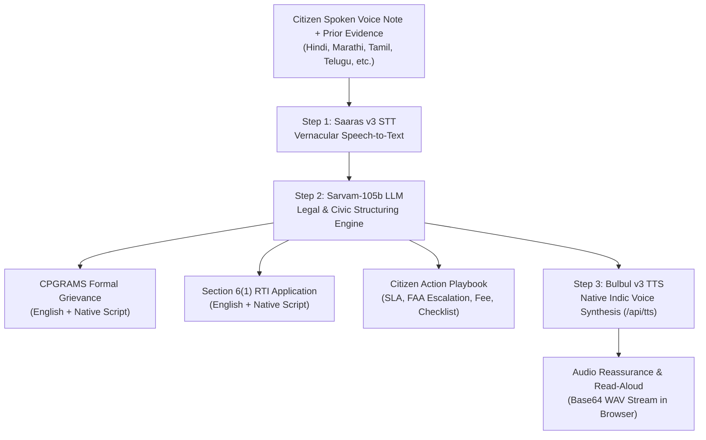

# Awaz-e-Shikayat (आवाज़-ए-शिकायत)
### *Grounded Indic Voice-to-CPGRAMS Grievance & RTI Copilot powered by Sarvam AI*

[-black?style=flat&logo=next.js)](https://nextjs.org/)
[](https://www.sarvam.ai/)
[](https://www.typescriptlang.org/)
[](https://tailwindcss.com/)

---

## 🏛️ The Problem Solved
Across India, hundreds of millions of citizens face severe public breakdowns—ruptured water pipelines, dangerous highway potholes, illegal denial of subsidized ration grain, and hospital negligence. 

While the Government of India provides powerful constitutional redress mechanisms—notably **CPGRAMS (Centralized Public Grievance Redress and Monitoring System)** and the **Right to Information (RTI) Act, 2005 (Section 6(1))**—most citizens are disenfranchised because:
1. Grievance portals demand formal legal and administrative English phrasing.
2. Citizens do not know which Central Ministry, State Department, or Urban Local Body (ULB) holds statutory jurisdiction.
3. Prior complaints and local rejection slips are routinely ignored unless paired with legally enforceable RTI questions requesting certified inspection logs, contractor agreements, and daily progress registers.

**Awaz-e-Shikayat** bridges this gap completely. A citizen speaks in their mother tongue (Hindi, Marathi, Tamil, Telugu, Kannada, Bengali), attaches any prior notice or receipt, and within seconds receives:
- A submission-ready, high-impact **CPGRAMS formal grievance** (in official English & translated Indic script).
- A legally enforceable **RTI Section 6(1) application** (in official English & translated Indic script).
- An actionable **Citizen Action Playbook** (Statutory SLA, First Appellate Authority, Fee Calculator, and Evidence Checklist).
- An empathetic **spoken voice confirmation** and on-demand audio read-aloud via Sarvam Bulbul v3.

---

## ⚡ 3-Step Sarvam AI Architecture Pipeline



1. **Step 1 — Speech-to-Text (`Saaras:v3`)**:
   Captures raw, code-mixed Indic audio directly from the browser microphone (`MediaRecorder`) or uploaded `.wav`/`.mp3`/`.webm` audio files and delivers high-fidelity vernacular transcripts.
2. **Step 2 — Legal & Civic Structuring (`sarvam-105b-conversations`)**:
   Analyzes the grievance, incorporates prior complaint/diary references, tags the official Indian ministry or civic body, classifies urgency (`Critical` / `High` / `Medium`), drafts a formal CPGRAMS petition with legal relief sought, formulates 4 sharp questions under Section 6(1) of the RTI Act 2005, translates drafts into native Indic scripts, and builds the Citizen Action Playbook.
3. **Step 3 — Native Voice Synthesis (`Bulbul:v3`)**:
   Synthesizes warm, empathetic audio confirmations and full-draft read-alouds (`/api/tts`) in the citizen's native language.

---

## 🌟 Hackathon Competition Features

### 1. 📎 Grounded RTI Mode
- Citizens can attach previous complaint receipts, rejection slips, or defect photos (images, PDF, or document) or enter their prior complaint/diary number (e.g. `JAL-2026-9021`).
- The pipeline grounds both drafts with surgical precision, demanding certified copies of actions taken on the prior intimation.

### 2. 🌐 Bilateral Transparency: "Read Draft in My Language"
- Dual-toggle view inside both CPGRAMS and RTI cards: **"Official English"** vs. **"My Language (Native Script)"**.
- **"Read Draft Aloud"** button powered by Sarvam Bulbul v3 via a dedicated `/api/tts` endpoint allows non-literate or visually impaired citizens to hear every legal clause spoken in their mother tongue.

### 3. 🛡️ Actionable Citizen Playbook
- **Statutory SLA Timeline**: Legal resolution window (e.g., 30 Days under RTI Sec 7(1); 48 Hours for Life & Liberty; 15-30 Days for CPGRAMS).
- **Statutory Fee Guidance**: Transparent cost information (₹10 Court Fee / IPO for RTI; ₹0 for CPGRAMS).
- **Escalation Hierarchy**: Exact title of the First Appellate Authority (FAA) or Nodal Grievance Redressal Officer.
- **Evidence Checklist**: 3 specific verification items before portal dispatch.
- **1-Click WhatsApp Share**: Formatted case file link (`https://wa.me/?text=...`) for instant mobile sharing.

### 4. 🖨️ Official Court/Portal-Ready Print & PDF Export
- Generates an official statutory application layout with:
  - Header: `APPLICATION UNDER SECTION 6(1) OF THE RTI ACT, 2005` or `FORMAL PUBLIC GRIEVANCE PETITION`
  - Case Reference ID (e.g. `AWSK-2026-XXXX`) and Filing Date
  - `[ Affix ₹10 Court Fee / IPO Stamp Here ]` box
  - Applicant statutory verification statement & signature placeholder
  - Browser print dialogue (`window.print()`) formatted cleanly via `@media print`.

### 5. 📊 Sarvam AI Pipeline Telemetry (Judge's Inspector Bar)
- Live collapsible telemetry bar tracking real millisecond latency and token usage for all 3 chained stages:
  - `Saaras v3 STT` latency (ms) & detected language code
  - `Sarvam-105b` latency (ms), prompt tokens, and completion tokens
  - `Bulbul v3 TTS` latency (ms) and audio stream format
  - Total end-to-end pipeline execution time.

---

## 🚀 Live Demo Presets (For Instant Evaluation)
No microphone needed! Three pre-grounded 1-click presets are available directly in the UI:
1. **Ward 14 Burst Pipeline (Hindi)**: Ministry of Jal Shakti • Cites Prior Receipt #JAL-2026-9021.
2. **Ration Grain Denial (Marathi)**: PDS / Civil Supplies • Cites Tehsildar Complaint #PDS-MH-4421.
3. **Highway Pothole Hazard (Tamil)**: NHAI / PWD • Cites Prior Token #NHAI-TN-1049.

---

## 🛠️ Local Setup & Run

### 1. Prerequisites
- Node.js 18+ (tested on Node v24)
- npm 9+
- A valid Sarvam AI API Key ([docs.sarvam.ai](https://docs.sarvam.ai/))

### 2. Installation
```bash
git clone <your-repo-url>
cd sarvam_proj
npm install
```

### 3. Environment Configuration
Create a `.env` (or `.env.local`) file in the project root:
```env
SARVAM_API_KEY=your_sarvam_api_key_here
```
> **Security Note:** `.env` and `.env*.local` are explicitly listed in `.gitignore`. Never commit API keys.

### 4. Standalone Verification Script
```bash
node verify_sarvam.mjs
```

### 5. Launch the Application
```bash
npm run dev
# or for production:
npm run build && npm start
```
Open [http://localhost:3000](http://localhost:3000) in your browser.

---

## 🚢 Production Deployment on Vercel

```bash
# Deploy to Vercel
npx vercel --prod

# Add your production environment variable
npx vercel env add SARVAM_API_KEY production
```

---

## 📄 License & Attribution
Built for the **Sarvam AI Hackathon**. Powered by the official `sarvamai` SDK.
